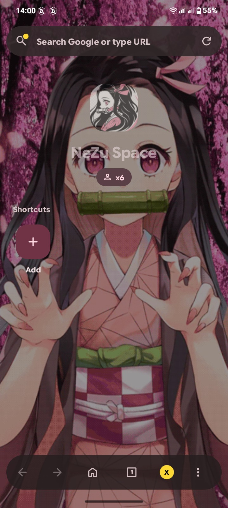
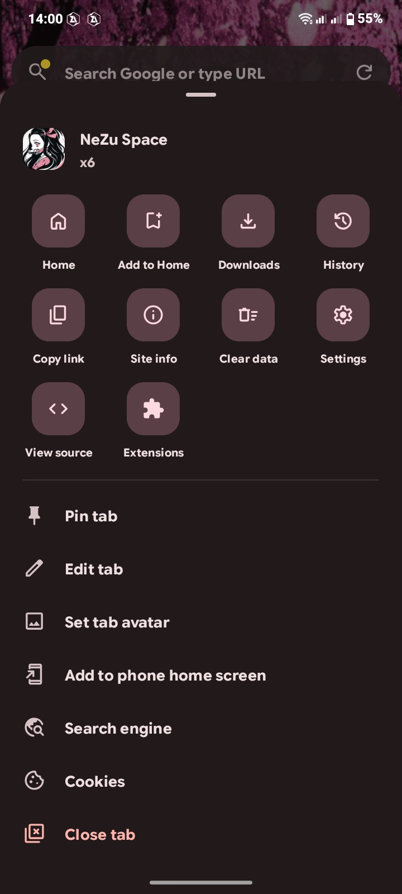
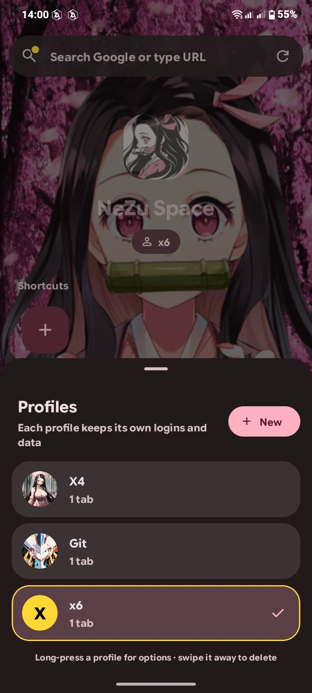
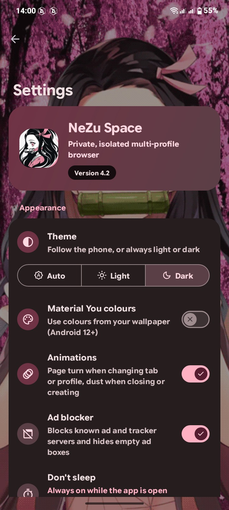
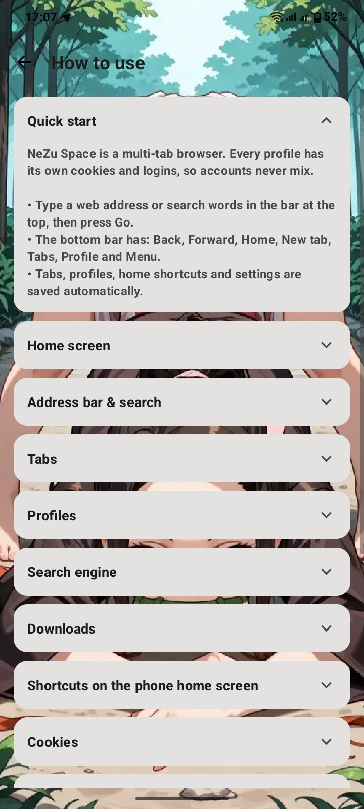

# NeZu Space

**A multi-tab Android browser where every tab and profile is isolated.**
Each profile has its own cookies, storage, cache, search engine, home shortcuts and downloads, so logins and sessions never mix.

**Author:** D.Paradox - Telegram: [@Parad0x1905006](https://t.me/Parad0x1905006)

## Screenshots

<table>
<tr>
  <td align="center"> Home screen</td>
  <td align="center"> Menu</td>
  <td align="center"> Profiles</td>
</tr>
<tr>
  <td align="center"> Settings</td>
  <td align="center"> In-app guide</td>
</tr>
</table>

## Features

### Tabs and profiles
- Isolated profiles through the WebView multi-profile API (needs Android System WebView 110 or newer).
- Swipe the address bar to change tab, swipe the bottom bar to change profile, swipe a tab card or profile row to close or delete it.
- Pin tabs; give tabs and profiles a name, colour or round picture (with a crop screen).
- Search engine per profile.
- Tab-count badge that shows the total tabs of the current profile.

### Home screen
- Native home with shortcut tiles that show the website's picture (touch icon, logo, favicon or your own image).
- Add a page with Menu > Add to Home, or pin a shortcut to the phone's home screen.
- Long-press a tile: open in background / new tab, sort, edit, delete, copy link, share.

### Downloads
- Per-profile download list with pause and resume, add a download by pasting a link, open, copy link, download again, delete.
- Files keep the real name the website gives them; downloads from sites that need a login work (profile cookies and referer are sent); `blob:` and `data:` links are supported.
- Long-press a picture in a page: view, download, share, search by image, copy link, mark as ad.

### Look
- Material 3 design with Material You colours (or the built-in rose palette), Google Sans Flex type, light / dark / system theme.
- Floating bottom dock, Material 3 search bar, bottom-sheet menu and profiles, large collapsing titles in Settings and the guide.
- Background: your own picture, an animated GIF or a looping video, with adjustable opacity and an optional video sound.
- Page-turn and dust animations for changing, closing and creating tabs and profiles (can be switched off).
- Sound effects with a master switch, a preview and your own audio for each event (tab/profile change, delete, create, app open).

### Privacy and security (Settings > Privacy & Security)
- App lock (fingerprint, face or phone lock), locked profiles, hidden screen in recent apps.
- Private profiles and "clear data when the app closes".
- Tracking removed from links, tracker blocking, third-party cookie blocking, HTTPS only, Safe Browsing.
- Asks before opening other apps; warns before risky or self-started downloads; certificate-error warning page.
- Camera, microphone and location are asked once per site and can be reset any time.
- Tabs, profiles, shortcuts and the download list are stored encrypted with a key in the Android Keystore.
- Menu > Site info shows the connection and certificate of the page.
- No account, no analytics, no tracking. See [PRIVACY.md](PRIVACY.md).

### Menu tools
- History (per profile, searchable), Cookies (copy / clear), Clear data (choose Cache, Form data, History, Web storage, Cookies, App cache), Downloads, Site info.
- "Don't sleep": keep the screen on always or for 5 / 15 / 30 minutes without a touch.
- Built-in ad blocker.
- An in-app guide: Settings > How to use NeZu Space.

## Requirements
- Android 8.0 (API 26) or newer.
- Android System WebView 110 or newer for isolated profiles.
- Safe Browsing needs Google Play services.

## Build
1. Install Android Studio (Koala or newer), choose *File > Open*, select this folder and wait for the Gradle sync (internet needed).
2. Debug APK: *Build > Build APK(s)*, or `./gradlew assembleDebug` -> `app/build/outputs/apk/debug/app-debug.apk`.
3. Release APK: `./gradlew assembleRelease`. The release build is signed with the debug key so it installs directly; use your own signing config before publishing.

## Project layout
| Path (`app/src/main/java/com/dparadox/tabspace`) | What it does |
|---|---|
| `MainActivity.kt` | Browser screen: tabs, profiles, menus, WebView clients, animations |
| `SettingsActivity.kt`, `GuideActivity.kt` | Settings and the in-app guide (edit the `topics` list) |
| `PrivacyPrefs.kt`, `LockScreen.kt`, `DataWiper.kt`, `SecureStore.kt` | Privacy settings, app lock, data clearing, encryption |
| `TabStore.kt`, `HistoryStore.kt` | Saved tabs / profiles and the history list |
| `DownloadEngine.kt`, `BlobBridge.kt`, `DownloadService.kt` | Downloads |
| `ThemePrefs.kt`, `VideoBackground.kt`, `CenterCropDrawable.kt` | Theme and picture / GIF / video background |
| `SoundFx.kt` | Sound effects |
| `AdBlocker.kt` | Ad and tracker blocking |

Store text and the icon for F-Droid are in `fastlane/metadata/android/en-US`.

## Contributing
See [CONTRIBUTING.md](CONTRIBUTING.md). Version history: [CHANGELOG.md](CHANGELOG.md).

## License
NeZu Space is free software: you can redistribute it and/or modify it under the terms of the **GNU General Public License v3.0 or later** (see [LICENSE](LICENSE)). It comes without any warranty.

    Copyright (C) 2026 D.Paradox

Libraries (AndroidX, Material Components, WebKit, Biometric) are Apache 2.0, which is compatible with GPLv3.

The Google Sans Flex font in `app/src/main/res/font` is licensed under the SIL Open Font License 1.1 (full text in `app/src/main/assets/GoogleSansFlex-OFL.txt`). Icons are Material Symbols (Apache 2.0).

The default *App open* sound in `app/src/main/res/raw` is a separate asset: it is only covered by the GPL if its author is the copyright holder. Replace it with a sound you own, or a CC0 / permissively licensed one, before publishing (for example to F-Droid).
